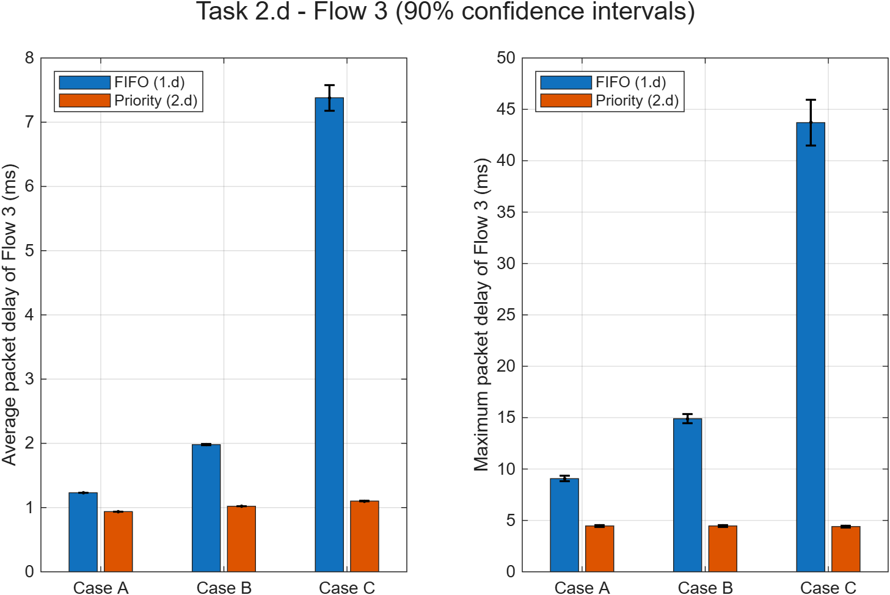

# MDRS — Mini-Projeto 1

**Avaliação de desempenho de ligações ponto-a-ponto com múltiplos fluxos de pacotes**

Modelação e Desempenho de Redes e Serviços · Mestrado em Engenharia de Computadores e Telemática · Universidade de Aveiro · 2026/2027

---

## Objetivo

Estudar, por simulação de eventos discretos e por modelos teóricos, uma ligação de **C = 10 Mbps** que transporta **3 fluxos de pacotes**. Comparam-se três algoritmos de escalonamento:

| Task | Algoritmo | O que se estuda |
|---|---|---|
| **1** | **FIFO** — uma fila única | Desempenho de cada fluxo e validação com o modelo **M/G/1** |
| **2** | **Priority Queuing** — Fluxo 3 com prioridade máxima | Diferenciação de atraso e validação com o **M/G/1 com prioridades** |
| **3** | **Deficit Round Robin** — uma fila por fluxo | Justiça entre fluxos e validação com o **max-min fairness ponderado** |

### Fluxos

| Fluxo | Tamanho dos pacotes (igual probabilidade) | Tamanho médio |
|---|---|---|
| 1 | 100 – 1500 Bytes | 800 B |
| 2 | 100 – 150 Bytes | 125 B |
| 3 | 500 – 1000 Bytes | 750 B |

### Casos de tráfego

| Caso | λ₁ | λ₂ | λ₃ (pps) | Carga ρ |
|---|---|---|---|---|
| A | 400 | 400 | 600 | 0,656 |
| B | 600 | 600 | 600 | 0,804 |
| C | 800 | 800 | 600 | 0,952 |
| D | 1000 | 1000 | 1000 | 1,340 (congestionado) |

Todas as simulações usam **50 corridas** de **P = 100 000 pacotes**, com **intervalos de confiança a 90%**.

---

## Estrutura do repositório

```
├── README.md
├── REPORTS/                        Relatório de cada Task (código explicado, resultados e conclusões)
│   ├── MiniProject1_Task1.md
│   ├── MiniProject1_Task2.md
│   └── MiniProject1_Task3.md
└── WORK/                           Código MATLAB, resultados e gráficos
    ├── Sim2Flows_original.m        Simulador fornecido (FIFO, 2 fluxos)
    ├── Sim2Flows_newversion.m      1.a  FIFO com 3 fluxos
    ├── Sim2FlowsPrio_newversion.m  2.a  Priority Queuing com 3 fluxos
    ├── Sim2FlowsDRR_newversion.m   3.a  Deficit Round Robin com 3 fluxos
    ├── Task1b.m … Task3e.m         Um script por alínea
    ├── Task*_resultados.mat        Resultados das simulações (50 corridas)
    ├── Task*.png                   Gráficos (média + IC 90%)
    └── GerarImagens.m              Corre todos os scripts e guarda os gráficos
```

---

## Como executar

Requisitos: MATLAB com a **Statistics and Machine Learning Toolbox** (`exprnd`, `norminv`).

```matlab
cd('WORK')
GerarImagens      % corre todas as simulações e guarda os PNG (~35-60 min)
```

Também se pode correr cada alínea à parte, por exemplo `Task1b`, `Task2d` ou `Task3e`.

Os scripts `Task1c`, `Task2c` e `Task3e` não simulam: calculam os valores teóricos e comparam-nos com os resultados guardados nos `.mat`. Por isso, `Task1b` deve correr antes de `Task1c`, `Task2b` antes de `Task2c`, e `Task3c`/`Task3d` antes de `Task3e`.

---

## Principais resultados

### Atraso médio por fluxo no caso C (ρ = 0,952)

| Algoritmo | Fluxo 1 | Fluxo 2 | Fluxo 3 |
|---|---|---|---|
| FIFO (1.b) | 7,10 ms | 6,56 ms | 7,05 ms |
| Prioridades (2.b) | 10,74 ms | 10,20 ms | **1,10 ms** |
| DRR, quanta iguais (3.b) | 10,05 ms | **2,02 ms** | 4,32 ms |

- **FIFO** não diferencia os fluxos: todos esperam na mesma fila e o atraso de cada um depende do tráfego dos outros.
- **PQ** protege o Fluxo 3, mas os Fluxos 1 e 2 pagam essa proteção.
- **DRR** protege quem envia pouco (Fluxo 2) e penaliza quem envia mais do que a sua parte (Fluxo 1).

### Atraso médio do Fluxo 3 com FIFO vs prioridades (1.d e 2.d)



Com FIFO, o atraso do Fluxo 3 cresce 6 vezes entre os casos A e C, embora o seu próprio tráfego seja sempre o mesmo. Com PQ, fica praticamente constante (cerca de 1 ms).

### Throughput no caso congestionado D com DRR (3.c, 3.d e 3.e)

| Quanta | | Fluxo 1 | Fluxo 2 | Fluxo 3 |
|---|---|---|---|---|
| 1500 / 1500 / 1500 | ideal (max-min) | 4,5 | 1,0 | 4,5 Mbps |
| | simulação | 4,500 | 0,999 | 4,500 Mbps |
| 1500 / 1500 / 4500 | ideal (max-min) | 3,0 | 1,0 | 6,0 Mbps |
| | simulação | 3,003 | 1,000 | 5,997 Mbps |

O DRR reparte a ligação exatamente segundo o **max-min fairness ponderado**, com os quanta como pesos. Os fluxos que pedem menos do que a sua parte não têm perdas, e o excesso de tráfego fica só em quem o provoca.

### Validação dos modelos teóricos

| Alínea | Modelo | Concordância com a simulação |
|---|---|---|
| 1.c | M/G/1 | Throughput exato; atraso cerca de 3,5% abaixo da teoria (ρ ≈ 0,95, grande variabilidade) |
| 1.d | M/G/1 | Teoria dentro do IC nos casos A, B e C |
| 2.c | M/G/1 com prioridades | Fluxo 3: 0,2% de diferença; Fluxos 1 e 2: cerca de 3,4% abaixo |
| 2.d | M/G/1 com prioridades | Diferenças ≤ 0,1% nos casos A, B e C |
| 3.e | Max-min fairness ponderado | Diferenças ≤ 0,1% |

---

## Relatórios detalhados

- [Task 1 — FIFO](REPORTS/MiniProject1_Task1.md)
- [Task 2 — Priority Queuing](REPORTS/MiniProject1_Task2.md)
- [Task 3 — Deficit Round Robin](REPORTS/MiniProject1_Task3.md)
