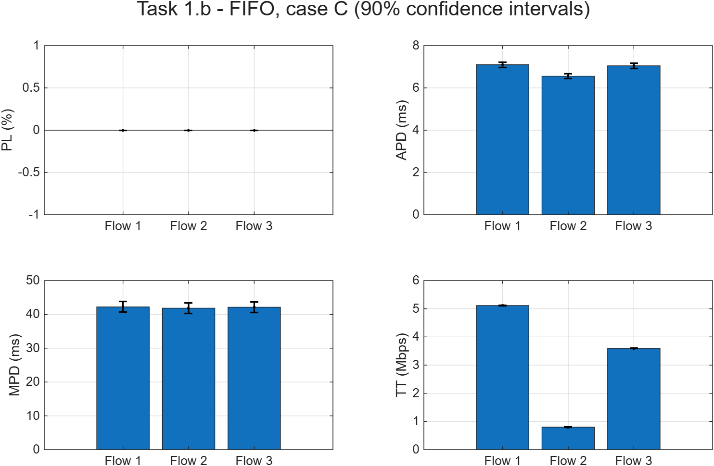
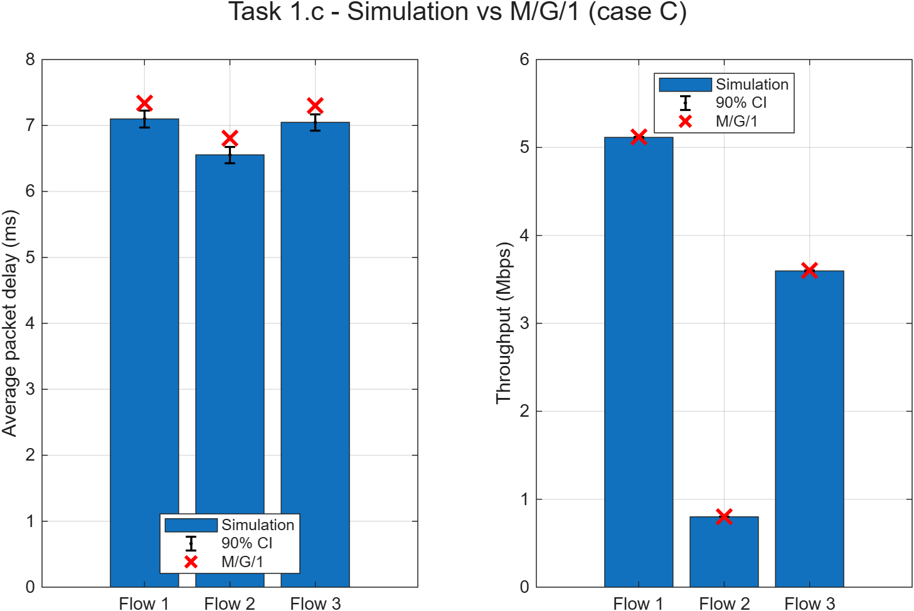
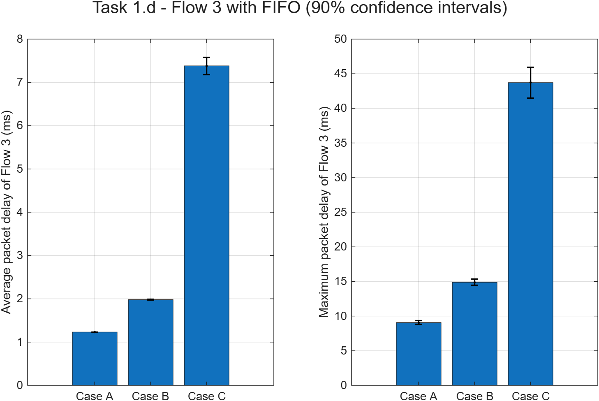

# Mini-Projeto 1 — Task 1 (FIFO com 3 fluxos)

**MDRS 2026/2027** · Ligação de **C = 10 Mbps** com uma fila FIFO única.

## Dados do problema

| Fluxo | Tamanho dos pacotes (igual probabilidade) | Tamanho médio E[B] | Tempo médio de transmissão E[S] = 8·E[B]/C |
|---|---|---|---|
| 1 | 100 a 1500 Bytes | 800 Bytes | 0,640 ms |
| 2 | 100 a 150 Bytes | 125 Bytes | 0,100 ms |
| 3 | 500 a 1000 Bytes | 750 Bytes | 0,600 ms |

| Caso | λ₁ (pps) | λ₂ (pps) | λ₃ (pps) | Carga ρ = Σ λᵢ·E[Sᵢ] |
|---|---|---|---|---|
| A | 400 | 400 | 600 | 0,656 |
| B | 600 | 600 | 600 | 0,804 |
| C | 800 | 800 | 600 | 0,952 |
| D | 1000 | 1000 | 1000 | 1,340 (congestionado) |

Em todas as simulações:
- 50 corridas por experiência;
- critério de paragem P = 100 000 pacotes transmitidos;
- intervalos de confiança a 90%: média ± z₀,₉₅·√(S²/N), com z₀,₉₅ = 1,6449 (Módulo 3, slide 21).

Ficheiros (pasta `WORK/`):

| Ficheiro | Alínea | O que faz |
|---|---|---|
| `Sim2Flows_original.m` | — | Simulador fornecido pelo professor (2 fluxos) |
| `Sim2Flows_newversion.m` | 1.a | Simulador FIFO para 3 fluxos |
| `Task1b.m` | 1.b | Simula o caso C (50 corridas) e guarda `Task1b_resultados.mat` |
| `Task1c.m` | 1.c | Calcula os valores teóricos M/G/1 e compara-os com a 1.b |
| `Task1d.m` | 1.d | Simula o Fluxo 3 nos casos A, B e C e guarda `Task1d_resultados.mat` |

---

## 1.a — Simulador `Sim2Flows_newversion`

O ponto de partida é o simulador do professor, `Sim2Flows_original` (Módulo 3, slide 10). Mantém-se a mesma lógica:
- uma fila FIFO única para todos os fluxos;
- dois eventos, `ARRIVAL` e `DEPARTURE`;
- um pacote que chega quando a fila não tem espaço é perdido;
- os mesmos parâmetros de saída: PL, APD, MPD e TT.

As alterações estão marcadas no código com `% ALTERAÇÃO`.

**Alteração 1 — Contadores estatísticos com 3 posições.** Cada posição do vetor guarda os valores de um fluxo, por isso o vetor passa a ter 3 posições:
```matlab
TOTALPACKETS= zeros(1,3);  LOSTPACKETS= zeros(1,3);  TRANSPACKETS= zeros(1,3);
TRANSBYTES=   zeros(1,3);  DELAYS=      zeros(1,3);  MAXDELAY=     zeros(1,3);
```

**Alteração 2 — Primeira chegada também para o Fluxo 3.** A lista de eventos começa com uma chegada de cada fluxo. Sem esta linha, o Fluxo 3 nunca teria pacotes:
```matlab
tmp= Clock + exprnd(1/lambda(3));
EventList = [EventList; ARRIVAL, tmp, GenerateSize(3), 3, tmp];
```

**Alteração 3 — Tamanho do próximo pacote conforme o fluxo.** O `if Flow==1 ... else ...` só servia para 2 fluxos. Passa a haver uma única chamada que recebe o ID do fluxo:
```matlab
nextPacketSize= GenerateSize(Flow);
```

**Alteração 4 — Gerador de tamanhos com as distribuições do enunciado.** As funções `GenerateSize1` e `GenerateSize2` (distribuições do exemplo das aulas) são substituídas por uma única função. Todos os valores têm igual probabilidade, por isso basta usar `randi` (Módulo 3, slide 13):
```matlab
function out= GenerateSize(Flow)
    switch Flow
        case 1
            out= randi([100 1500]);   % Flow 1
        case 2
            out= randi([100 150]);    % Flow 2
        case 3
            out= randi([500 1000]);   % Flow 3
    end
end
```

---

## 1.b — Simulação do caso C (f = 1 000 000 Bytes)

O script `Task1b.m` corre `Sim2Flows_newversion([800 800 600], 10, 1e6, 1e5)` 50 vezes. Guarda cada resultado numa matriz (linha = corrida, coluna = fluxo) e calcula a média e o intervalo de confiança de cada parâmetro.



**Resultados (média ± IC 90%):**

| Parâmetro | Fluxo 1 | Fluxo 2 | Fluxo 3 |
|---|---|---|---|
| Perda de pacotes PL (%) | 0 | 0 | 0 |
| Atraso médio APD (ms) | 7,10 ± 0,13 | 6,56 ± 0,12 | 7,05 ± 0,12 |
| Atraso máximo MPD (ms) | 42,2 ± 1,5 | 41,8 ± 1,6 | 42,1 ± 1,6 |
| Throughput TT (Mbps) | 5,115 ± 0,007 | 0,800 ± 0,001 | 3,596 ± 0,005 |

**Justificação:**
- **Não há perdas.** A fila de 1 000 000 Bytes nunca chega a encher com ρ = 0,952.
- **O throughput de cada fluxo é igual ao débito que chega** (λᵢ·8·E[Bᵢ] = 5,12, 0,80 e 3,60 Mbps), porque todos os pacotes que chegam são transmitidos.
- **Os atrasos médios são quase iguais.** Os 3 fluxos partilham a mesma fila FIFO e, por isso, têm o mesmo atraso médio na fila (cerca de 6,45 ms). A diferença entre eles é só o tempo de transmissão do próprio pacote:
  - Fluxo 2 (pacotes de 125 B): 0,10 ms, por isso tem o atraso mais baixo;
  - Fluxo 1: 0,64 ms;
  - Fluxo 3: 0,60 ms.

  A diferença entre o Fluxo 1 e o Fluxo 2 é 7,10 − 6,56 = 0,54 ms = 0,64 − 0,10 ms, exatamente a diferença entre os tempos médios de transmissão.
- **Os atrasos máximos são praticamente iguais (cerca de 42 ms).** O pior caso acontece nos picos de congestionamento, e nesses momentos os pacotes de todos os fluxos estão presos na mesma fila.
- **O atraso na fila é cerca de 10 vezes o tempo de transmissão**, porque a ligação está quase saturada (ρ ≈ 0,95).
- Com FIFO, um fluxo de pacotes pequenos como o Fluxo 2 sofre praticamente o mesmo atraso que os outros. O seu atraso depende do tráfego dos outros fluxos (Módulo 4, slide 5).

---

## 1.c — Modelo teórico M/G/1 (caso C)

**Porque é que o M/G/1 se aplica:**
- as chegadas de cada fluxo são processos de Poisson, e a soma de processos de Poisson é um processo de Poisson com λ = Σλᵢ (Módulo 1, slide 28);
- o tempo de transmissão tem uma distribuição geral (não exponencial);
- há um único servidor (a ligação);
- a fila é muito grande.

**Fórmulas (Módulo 2, slides 36–37):**

| Grandeza | Fórmula |
|---|---|
| Taxa total | λ = λ₁ + λ₂ + λ₃ = 2200 pps |
| Média do agregado | E[S] = Σ (λᵢ/λ)·E[Sᵢ] |
| 2.º momento do agregado | E[S²] = Σ (λᵢ/λ)·E[Sᵢ²] |
| Carga | ρ = λ·E[S] = 0,952 |
| Atraso na fila (Pollaczek-Khintchine), igual para todos os fluxos | W_Q = λ·E[S²] / (2(1−ρ)) = 6,704 ms |
| Atraso médio do fluxo i | Wᵢ = W_Q + E[Sᵢ] |
| Throughput do fluxo i (sem perdas) | TTᵢ = λᵢ·8·E[Bᵢ] |

O simulador não tem atraso de propagação, por isso Wᵢ também não o inclui.

**Código (`Task1c.m`, parte teórica):**
```matlab
ES  = [mean(8*B1/C)      mean(8*B2/C)      mean(8*B3/C)];       % E[S_i]
ES2 = [mean((8*B1/C).^2) mean((8*B2/C).^2) mean((8*B3/C).^2)];  % E[S_i^2]
lambdaT = sum(lambda);
ESagr   = sum(lambda/lambdaT .* ES);
ES2agr  = sum(lambda/lambdaT .* ES2);
rho     = lambdaT * ESagr;
WQ      = lambdaT * ES2agr / (2 * (1 - rho));
APDteo  = (WQ + ES) * 1e3;                 % ms
TTteo   = lambda * 8 .* EB / 1e6;          % Mbps
```
`mean(...)` dá a média e o 2.º momento porque todos os tamanhos têm a mesma probabilidade.



**Comparação com a simulação:**

| | Fluxo 1 | Fluxo 2 | Fluxo 3 |
|---|---|---|---|
| APD — M/G/1 (ms) | 7,344 | 6,804 | 7,304 |
| APD — simulação (ms) | 7,099 ± 0,126 | 6,555 ± 0,123 | 7,048 ± 0,124 |
| Diferença relativa | −3,3% | −3,7% | −3,5% |
| TT — M/G/1 (Mbps) | 5,120 | 0,800 | 3,600 |
| TT — simulação (Mbps) | 5,115 ± 0,007 | 0,800 ± 0,001 | 3,596 ± 0,005 |

**Conclusões:**
- **O throughput teórico coincide com a simulação** em todos os fluxos (diferenças < 0,1%, dentro dos intervalos de confiança).
- **O atraso médio simulado fica cerca de 3,5% abaixo do valor teórico**, um pouco fora do intervalo de confiança a 90%. A tendência está correta: a diferença entre fluxos é a prevista (só o tempo de transmissão) e todos os valores ficam próximos do M/G/1. As diferenças devem-se a:
  1. **Variabilidade muito elevada do atraso com ρ ≈ 0,95.** Perto da saturação, o atraso de cada corrida depende de poucos períodos de congestionamento muito longos. Com só 50 corridas, o intervalo de confiança subestima a incerteza real. A prova está na própria simulação: o atraso médio do Fluxo 3 no caso C foi estimado duas vezes, de forma independente:
     - na 1.b: 7,05 ± 0,12 ms;
     - na 1.d: 7,38 ± 0,20 ms.

     Os dois intervalos quase não se tocam, e o valor teórico (7,30 ms) fica entre os dois.
  2. **Efeito de *warm-up* (Módulo 3, slide 23).** Cada corrida começa com o sistema vazio e os contadores são inicializados no início. Os primeiros pacotes têm atrasos abaixo do regime estacionário, o que puxa a média para baixo.
- Mais corridas, ou corridas mais longas (P maior), reduziriam estas diferenças.
- O M/G/1 é o modelo adequado: chegadas de Poisson, serviço geral, um servidor e fila praticamente infinita são exatamente as hipóteses do modelo. Se se usasse o M/M/1 (tamanhos exponenciais), o resultado seria diferente, porque o 2.º momento dos tamanhos uniformes é diferente do 2.º momento da exponencial.

---

## 1.d — Fluxo 3 nos casos A, B e C (f = 1 000 000 Bytes)

O script `Task1d.m` corre 50 simulações por caso (150 no total) e guarda apenas o APD e o MPD do Fluxo 3. A coluna "M/G/1" é calculada com as fórmulas da 1.c.



| Caso | ρ | APD Fluxo 3 — simulação | APD Fluxo 3 — M/G/1 | MPD Fluxo 3 — simulação |
|---|---|---|---|---|
| A | 0,656 | 1,231 ± 0,003 ms | 1,231 ms | 9,07 ± 0,26 ms |
| B | 0,804 | 1,981 ± 0,009 ms | 1,974 ms | 14,9 ± 0,4 ms |
| C | 0,952 | 7,38 ± 0,20 ms | 7,30 ms | 43,7 ± 2,2 ms |

**Justificação e conclusões:**
- **O tráfego do Fluxo 3 é sempre o mesmo (600 pps).** Só aumenta o tráfego dos Fluxos 1 e 2, e mesmo assim o atraso médio do Fluxo 3 é 6 vezes maior entre os casos A e C (1,23 → 7,38 ms). Com FIFO **não há isolamento entre fluxos**: o desempenho de um fluxo depende do tráfego dos outros.
- **O atraso não cresce linearmente com a carga.** De A para B, ρ aumenta 0,15 e o atraso aumenta 0,75 ms. De B para C, ρ aumenta 0,15 e o atraso aumenta 5,4 ms. Isto vem do termo 1/(1−ρ) da fórmula de Pollaczek-Khintchine, que dispara quando ρ se aproxima de 1.
- **O atraso máximo cresce ainda mais** (9 → 44 ms), porque com mais carga os períodos de congestionamento são mais longos e as filas acumulam mais pacotes.
- **Os intervalos de confiança alargam com a carga** (±0,003 ms em A, ±0,20 ms em C). Perto da saturação o sistema é muito mais variável (ver a discussão na 1.c).
- **Nos 3 casos a simulação coincide com o M/G/1**: o valor teórico está dentro do intervalo de confiança.
- Para um serviço sensível ao atraso, como é o caso do Fluxo 3, FIFO não garante qualquer qualidade de serviço. Esta é a motivação para a Task 2 (prioridades) e a Task 3 (DRR).

---

## Nota sobre a execução

- Os simuladores usam `exprnd` e `norminv`, que exigem a **Statistics and Machine Learning Toolbox**.
- Os gráficos (barras com a média e barras de erro com o IC a 90%) são produzidos no fim de cada script. O `GerarImagens.m` corre todos os scripts e guarda os PNG.
