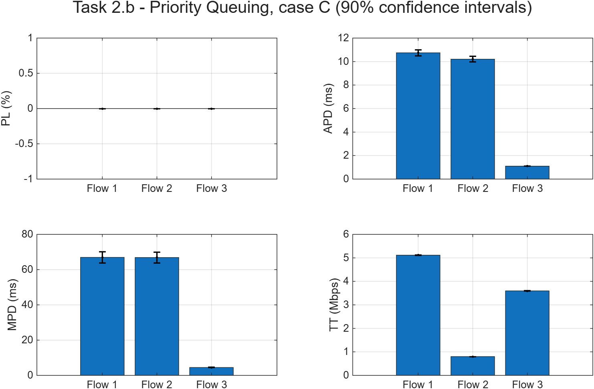
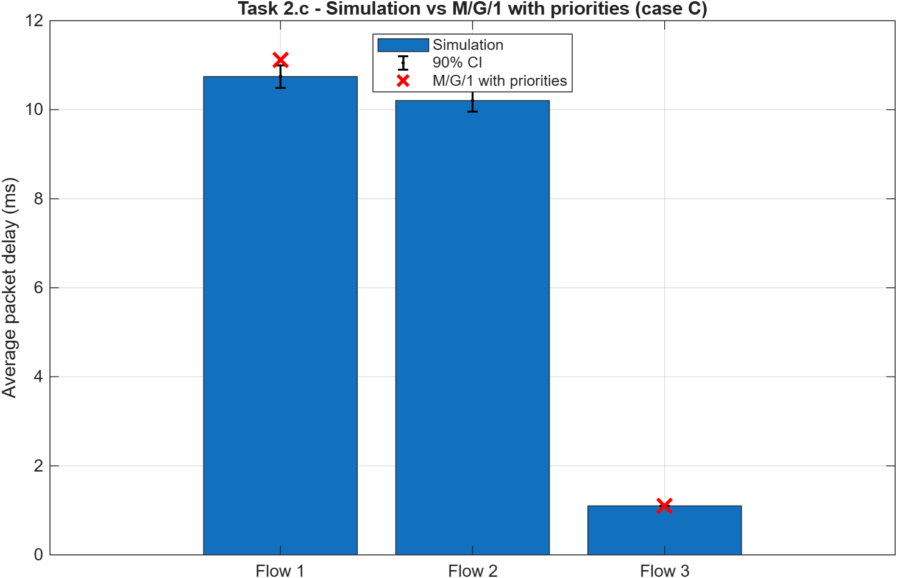
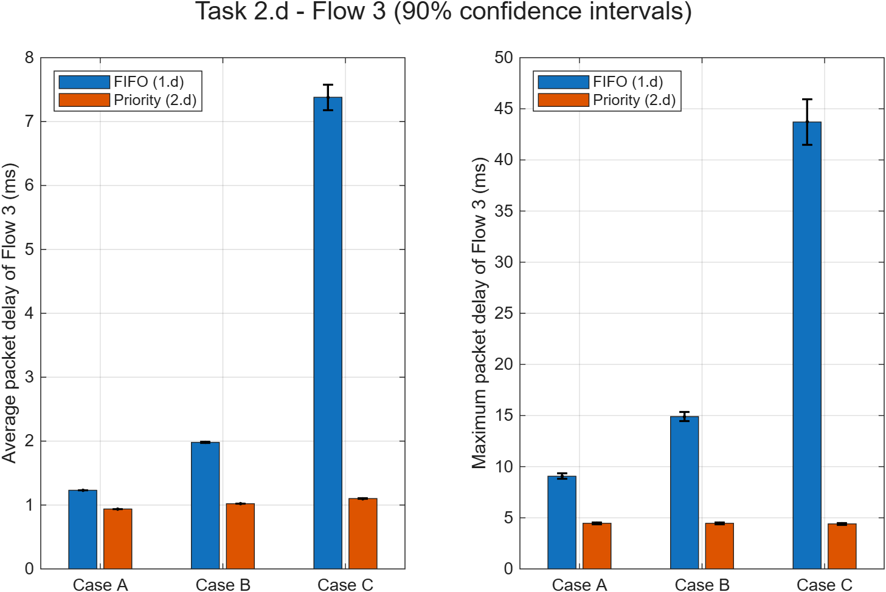

# Mini-Projeto 1 — Task 2 (Priority Queuing com 3 fluxos)

**MDRS 2026/2027** · Ligação de **C = 10 Mbps**.

- **Fluxo 3:** prioridade mais alta.
- **Fluxos 1 e 2:** segunda prioridade.
- **Filas:** f₁ = f₂ = 1 000 000 Bytes.

Os dados dos fluxos e dos casos são os mesmos da Task 1:

| Fluxo | Tamanhos | E[B] | E[S] |
|---|---|---|---|
| 1 | 100–1500 B | 800 B | 0,640 ms |
| 2 | 100–150 B | 125 B | 0,100 ms |
| 3 | 500–1000 B | 750 B | 0,600 ms |

Em todas as simulações: 50 corridas, P = 100 000 e intervalos de confiança a 90% (média ± 1,6449·√(S²/N)).

Ficheiros (pasta `WORK/`):

| Ficheiro | Alínea | O que faz |
|---|---|---|
| `Sim2FlowsPrio_newversion.m` | 2.a | Simulador com 2 filas de prioridade e 3 fluxos |
| `Task2b.m` | 2.b | Simula o caso C (50 corridas) e guarda `Task2b_resultados.mat` |
| `Task2c.m` | 2.c | Calcula os valores do M/G/1 com prioridades e compara-os com a 2.b |
| `Task2d.m` | 2.d | Simula o Fluxo 3 nos casos A, B e C; o gráfico compara FIFO (1.d) com prioridades |

---

## 2.a — Simulador `Sim2FlowsPrio_newversion`

O ponto de partida é o `Sim2Flows_newversion` da Task 1, que já trata 3 fluxos. Os eventos, os contadores e o cálculo dos parâmetros não mudam. As alterações estão marcadas no código com `% ALTERAÇÃO`.

**Alteração 1 — Tamanho de cada fila.** O parâmetro `f` passa a ser o vetor `[f1 f2]`:
- `f1`: tamanho da fila de prioridade alta;
- `f2`: tamanho da fila de prioridade baixa.

Se for dado um único valor, as duas filas ficam com esse tamanho:
```matlab
if isscalar(f)
    f= [f f];
end
```

**Alteração 2 — Prioridade de cada fluxo.** Este vetor indica a fila de cada fluxo (1 = prioridade alta, 2 = prioridade baixa):
```matlab
PRIO= [2 2 1];    % Flows 1 e 2 -> fila 2 | Flow 3 -> fila 1
```

**Alteração 3 — Uma fila por prioridade.** O PQ precisa de uma fila por prioridade (Módulo 4, slide 6). Por isso, a fila única passa a duas filas, cada uma com a sua ocupação:
```matlab
QUEUEOCCUPATION= [0 0];   % ocupação (Bytes) de cada fila
QUEUE= {[], []};          % cell array: QUEUE{1} = prioridade alta, QUEUE{2} = prioridade baixa
```

**Alteração 4 — Chegada de um pacote com a ligação ocupada.** O pacote vai para a fila da sua prioridade e só é perdido se essa fila não tiver espaço. Um fluxo de prioridade baixa nunca ocupa espaço na fila de prioridade alta.
```matlab
q= PRIO(Flow);
if QUEUEOCCUPATION(q) + PacketSize <= f(q)
    QUEUE{q}= [QUEUE{q}; PacketSize , Clock, Flow];
    QUEUEOCCUPATION(q)= QUEUEOCCUPATION(q) + PacketSize;
else
    LOSTPACKETS(Flow)= LOSTPACKETS(Flow) + 1;
end
```

**Alteração 5 — Escolha do próximo pacote a transmitir.** No fim de cada transmissão, o próximo pacote vem da primeira fila não vazia, por ordem de prioridade. Assim, os pacotes de uma prioridade só são transmitidos quando não há pacotes de prioridade mais alta à espera. Dentro de cada fila, a ordem é a de chegada (FIFO).
```matlab
q= find(QUEUEOCCUPATION > 0, 1);   % 1.ª fila não vazia
if ~isempty(q)
    QSize= QUEUE{q}(1,1);  QInstant= QUEUE{q}(1,2);  QFlow= QUEUE{q}(1,3);
    EventList = [EventList; DEPARTURE, Clock + 8*QSize/(C*1e6), QSize, QFlow, QInstant];
    QUEUEOCCUPATION(q)= QUEUEOCCUPATION(q) - QSize;
    QUEUE{q}(1,:)= [];
else
    STATE= 0;
end
```

O algoritmo continua a ser *work conserving* (Módulo 4, slide 4): a ligação só fica livre quando as duas filas estão vazias.

---

## 2.b — Simulação do caso C (f₁ = f₂ = 1 000 000 Bytes)



**Resultados (média ± IC 90%):**

| Parâmetro | Fluxo 1 | Fluxo 2 | Fluxo 3 |
|---|---|---|---|
| Perda de pacotes PL (%) | 0 | 0 | 0 |
| Atraso médio APD (ms) | 10,74 ± 0,25 | 10,20 ± 0,25 | 1,101 ± 0,002 |
| Atraso máximo MPD (ms) | 67,0 ± 3,1 | 66,9 ± 3,1 | 4,48 ± 0,09 |
| Throughput TT (Mbps) | 5,114 ± 0,007 | 0,800 ± 0,001 | 3,596 ± 0,005 |

**Justificação dos resultados entre fluxos:**
- **O Fluxo 3 tem atrasos muito mais baixos** (1,1 ms em média e 4,5 ms no máximo). Os seus pacotes passam à frente de todos os pacotes dos Fluxos 1 e 2. Só esperam por:
  - o pacote que estiver a ser transmitido nesse momento (pode ser de qualquer fluxo);
  - outros pacotes do próprio Fluxo 3.

  O Fluxo 3 sozinho ocupa só ρ₃ = 0,36 da ligação, por isso a sua fila é quase sempre curta.
- **Os Fluxos 1 e 2 têm atrasos semelhantes entre si** (10,7 ms e 10,2 ms). Partilham a mesma fila FIFO de prioridade baixa e por isso esperam o mesmo. A diferença (0,54 ms) é exatamente a diferença entre os tempos de transmissão de cada pacote (0,64 − 0,10 ms).
- **Não há perdas**, porque as filas de 1 000 000 Bytes nunca enchem.
- **O throughput de cada fluxo é igual ao débito que chega** (5,12 / 0,80 / 3,60 Mbps). A carga total é ρ = 0,952 < 1, por isso tudo o que chega acaba por ser transmitido. As prioridades mudam *quando* cada pacote é transmitido, não *quanto* é transmitido.
- **Intervalos de confiança:** o do Fluxo 3 é muito estreito (±0,002 ms), porque o seu atraso é estável. Os dos Fluxos 1 e 2 são largos, porque estes fluxos absorvem toda a variabilidade do sistema.

**Comparação com a Task 1.b (FIFO):**

| APD (ms) | Fluxo 1 | Fluxo 2 | Fluxo 3 |
|---|---|---|---|
| FIFO (1.b) | 7,10 | 6,56 | 7,05 |
| Prioridades (2.b) | 10,74 | 10,20 | 1,10 |

| MPD (ms) | Fluxo 1 | Fluxo 2 | Fluxo 3 |
|---|---|---|---|
| FIFO (1.b) | 42,2 | 41,8 | 42,1 |
| Prioridades (2.b) | 67,0 | 66,9 | 4,48 |

- Com FIFO, os três fluxos têm praticamente o mesmo atraso, porque esperam todos na mesma fila. Com PQ há **diferenciação de atraso**: o Fluxo 3 ganha cerca de 6 ms no atraso médio e cerca de 38 ms no atraso máximo. Os Fluxos 1 e 2 perdem cerca de 3,6 ms no médio e cerca de 25 ms no máximo.
- **Ninguém ganha "de graça".** O PQ redistribui o atraso entre fluxos, mas não o reduz no total. A média dos atrasos na fila, pesada pela carga ρᵢ de cada fluxo, é a mesma com FIFO e com PQ (lei de conservação de Kleinrock, válida para algoritmos *work conserving* com tamanhos de pacote que não dependem da prioridade). Com os valores simulados:
  - **PQ:** (0,36 × 0,50 + 0,592 × 10,10) / 0,952 ≈ **6,47 ms**;
  - **FIFO:** ≈ **6,46 ms** (atraso na fila da 1.b).
- O **throughput e as perdas não mudam**, porque com ρ < 1 e filas grandes a ligação transmite tudo nos dois casos.
- Os Fluxos 1 e 2 ainda não sofrem *starvation* (Módulo 4, slide 6), porque o Fluxo 3 sozinho só ocupa 36% da ligação. Se ρ₃ se aproximasse de 1, os Fluxos 1 e 2 quase nunca seriam transmitidos.

---

## 2.c — Modelo teórico M/G/1 com prioridades (caso C)

**Fórmulas (Módulo 4, slide 7)**, para filas muito grandes e chegadas de Poisson. O atraso médio na fila da prioridade k é:

| Prioridade | Fórmula |
|---|---|
| k = 1 (mais alta) | W_Q,1 = Σᵢ λᵢ·E[Sᵢ²] / (2·(1 − ρ₁)) |
| k > 1 | W_Q,k = Σᵢ λᵢ·E[Sᵢ²] / (2·(1 − ρ₁ − … − ρₖ₋₁)·(1 − ρ₁ − … − ρₖ)) |

- O numerador Σᵢ λᵢ·E[Sᵢ²] soma **todos** os fluxos, incluindo os de prioridade mais baixa. Representa o tempo de espera até acabar o pacote que já está a ser transmitido quando o novo pacote chega.
- ρ₁ = λ₃·E[S₃] = **0,36** (Fluxo 3).
- ρ₂ = λ₁·E[S₁] + λ₂·E[S₂] = 0,512 + 0,08 = **0,592** (Fluxos 1 e 2).
- Condição de validade: ρ₁ + ρ₂ = 0,952 < 1 ✓.

O atraso médio de cada fluxo é o atraso na fila da sua prioridade mais o tempo de transmissão do próprio pacote: Wᵢ = W_Q,k + E[Sᵢ].

**Código (`Task2c.m`, parte teórica):**
```matlab
ES  = [mean(8*B1/C)      mean(8*B2/C)      mean(8*B3/C)];       % E[S_i]
ES2 = [mean((8*B1/C).^2) mean((8*B2/C).^2) mean((8*B3/C).^2)];  % E[S_i^2]
rho = lambda .* ES;                                             % rho de cada fluxo
num = sum(lambda .* ES2);                                       % soma de TODOS os fluxos

rhoA = rho(3);                                                  % prioridade 1: Flow 3
WQ_alta  = num / (2 * (1 - rhoA));

rhoB = rho(1) + rho(2);                                         % prioridade 2: Flows 1 e 2
WQ_baixa = num / (2 * (1 - rhoA) * (1 - rhoA - rhoB));

APDteo = ([WQ_baixa WQ_baixa WQ_alta] + ES) * 1e3;              % ms
```

Valores intermédios:
- W_Q (prioridade alta) = 0,503 ms;
- W_Q (prioridade baixa) = 10,475 ms.



**Comparação com a simulação:**

| APD (ms) | Fluxo 1 | Fluxo 2 | Fluxo 3 |
|---|---|---|---|
| M/G/1 com prioridades | 11,115 | 10,575 | 1,103 |
| Simulação (2.b) | 10,745 ± 0,252 | 10,205 ± 0,247 | 1,101 ± 0,002 |
| Diferença relativa | −3,3% | −3,5% | −0,2% |

**Conclusões:**
- **Fluxo 3 (prioridade alta):** a teoria e a simulação coincidem (1,103 contra 1,101 ms, diferença de 0,2%). Este fluxo vê uma carga baixa (ρ₁ = 0,36), por isso o seu atraso é estável e fácil de estimar.
- **Fluxos 1 e 2 (prioridade baixa):** a simulação fica cerca de 3,4% abaixo da teoria, ligeiramente fora do intervalo de confiança a 90%. É o mesmo efeito observado na 1.c. Estes fluxos absorvem toda a variabilidade de uma ligação com ρ = 0,952. Com só 50 corridas, o intervalo de confiança subestima a incerteza real, e o efeito de *warm-up* (cada corrida começa vazia) puxa a média para baixo (Módulo 3, slide 23).
- Apesar dessa pequena diferença, o modelo descreve corretamente o comportamento:
  - a diferença entre os Fluxos 1 e 2 é exatamente a prevista;
  - a redução do atraso do Fluxo 3 em relação ao FIFO é a prevista;
  - o aumento do atraso dos Fluxos 1 e 2 é o previsto.
- O modelo explica porque é que o Fluxo 3 continua a ter algum atraso na fila (0,5 ms) apesar de ter a prioridade máxima. O PQ do enunciado é **não preemptivo**: um pacote do Fluxo 3 que chega a meio da transmissão de um pacote do Fluxo 1, que pode ter até 1500 B (1,2 ms), tem de esperar que essa transmissão termine. É isso que representa o termo Σλᵢ·E[Sᵢ²] no numerador.
- O termo (1 − ρ₁)·(1 − ρ₁ − ρ₂) = 0,64 × 0,048 no denominador da prioridade baixa é o que faz o atraso dos Fluxos 1 e 2 disparar. Eles "veem" uma ligação com ρ total = 0,952 e, além disso, só têm a capacidade que o Fluxo 3 deixa livre.

---

## 2.d — Fluxo 3 nos casos A, B e C (f₁ = f₂ = 1 000 000 Bytes)

O script `Task2d.m` corre 50 simulações por caso com `Sim2FlowsPrio_newversion` e guarda o APD e o MPD do Fluxo 3. O gráfico mostra lado a lado os resultados com FIFO (1.d) e com prioridades (2.d). A coluna "M/G/1 prio." usa as fórmulas da 2.c.



| Caso | ρ total | APD Fluxo 3 — PQ (sim.) | APD Fluxo 3 — M/G/1 prio. | MPD Fluxo 3 — PQ (sim.) |
|---|---|---|---|---|
| A | 0,656 | 0,938 ± 0,001 ms | 0,939 ms | 4,47 ± 0,11 ms |
| B | 0,804 | 1,021 ± 0,001 ms | 1,021 ms | 4,46 ± 0,09 ms |
| C | 0,952 | 1,102 ± 0,001 ms | 1,103 ms | 4,40 ± 0,09 ms |

**Comparação com a Task 1.d (FIFO):**

| Caso | APD Fluxo 3 — FIFO (1.d) | APD Fluxo 3 — PQ (2.d) | MPD Fluxo 3 — FIFO (1.d) | MPD Fluxo 3 — PQ (2.d) |
|---|---|---|---|---|
| A | 1,231 ms | 0,938 ms | 9,07 ms | 4,47 ms |
| B | 1,981 ms | 1,021 ms | 14,9 ms | 4,46 ms |
| C | 7,38 ms | 1,102 ms | 43,7 ms | 4,40 ms |

**Justificação e conclusões:**
- **Com PQ, o desempenho do Fluxo 3 quase não depende do tráfego dos outros fluxos.** Entre os casos A e C, o atraso médio só sobe de 0,94 para 1,10 ms (+17%) e o atraso máximo fica constante (cerca de 4,4–4,5 ms). Com FIFO, o atraso médio sobe 6 vezes e o máximo quase 5 vezes.
- **Porque é que o atraso médio ainda sobe um pouco:** com PQ, a fila do Fluxo 3 só "vê" o seu próprio tráfego, ρ₁ = 0,36, que é igual nos 3 casos. Mas o numerador Σλᵢ·E[Sᵢ²] cresce com o tráfego dos Fluxos 1 e 2. Com mais tráfego, é mais provável que um pacote do Fluxo 3 chegue a meio da transmissão de um pacote do Fluxo 1, e tenha de esperar que ela termine (PQ não preemptivo).
- **O atraso máximo fica constante e baixo.** No pior caso, o pacote do Fluxo 3 espera:
  - um pacote grande de prioridade baixa (até 1500 B = 1,2 ms);
  - os pacotes do próprio Fluxo 3 que já estão na fila.

  Nenhuma destas parcelas depende da carga dos Fluxos 1 e 2.
- **A diferença entre FIFO e PQ aumenta com a carga.** No caso A a melhoria é de 24% no atraso médio; no caso C, o atraso médio é cerca de 6,7 vezes menor e o máximo cerca de 10 vezes menor. A prioridade é mais útil precisamente quando a ligação está mais congestionada.
- **Os resultados coincidem com o M/G/1 com prioridades** nos 3 casos (diferenças ≤ 0,1%).
- **Contrapartida:** isto só é possível à custa dos Fluxos 1 e 2 (ver 2.b). Se o Fluxo 3 tivesse muito mais tráfego, poderia levar à *starvation* dos fluxos de prioridade baixa. É esse o problema que o DRR (Task 3) resolve.
