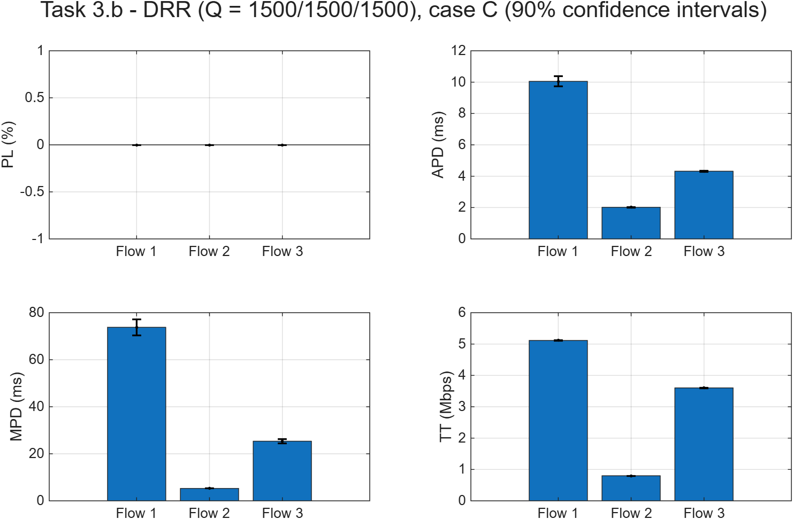
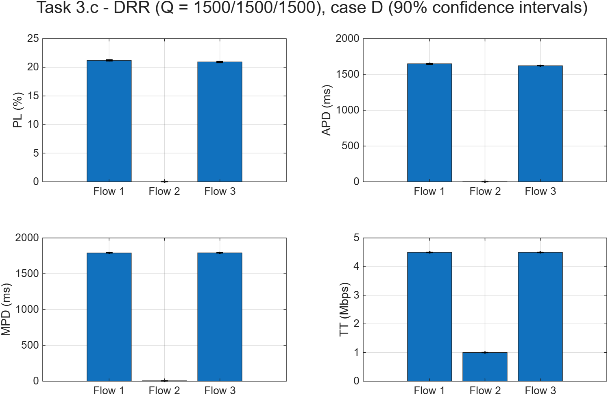
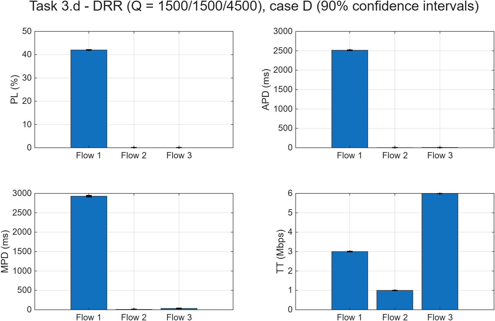

# Mini-Projeto 1 — Task 3 (Deficit Round Robin com 3 fluxos)

**MDRS 2026/2027** · Ligação de **C = 10 Mbps**.

- Uma fila DRR por fluxo, com f₁ = f₂ = f₃ = 1 000 000 Bytes.
- Em cada ronda, os fluxos são servidos pela ordem do ID: 1, 2, 3.

| Fluxo | Tamanhos | E[B] | Débito pedido no caso C | Débito pedido no caso D |
|---|---|---|---|---|
| 1 | 100–1500 B | 800 B | 5,12 Mbps | 6,4 Mbps |
| 2 | 100–150 B | 125 B | 0,80 Mbps | 1,0 Mbps |
| 3 | 500–1000 B | 750 B | 3,60 Mbps | 6,0 Mbps |
| **Total** | | | **9,52 Mbps (ρ = 0,952)** | **13,4 Mbps (ρ = 1,34)** |

Em todas as simulações: 50 corridas, P = 100 000 e intervalos de confiança a 90% (média ± 1,6449·√(S²/N)).

Ficheiros (pasta `WORK/`):

| Ficheiro | Alínea | O que faz |
|---|---|---|
| `Sim2FlowsDRR_newversion.m` | 3.a | Simulador DRR com 3 filas, fila final e créditos |
| `Task3b.m` | 3.b | Caso C, Q = 1500/1500/1500 |
| `Task3c.m` | 3.c | Caso D, Q = 1500/1500/1500 |
| `Task3d.m` | 3.d | Caso D, Q = 1500/1500/4500 |
| `Task3e.m` | 3.e | Max-min fairness ponderado e comparação com a 3.c e a 3.d |

---

## 3.a — Simulador `Sim2FlowsDRR_newversion`

O ponto de partida é o `Sim2Flows_newversion` da Task 1. A assinatura passa a ter mais um argumento, o vetor `Quantum` com o quantum (em Bytes) de cada fluxo:
```matlab
function [PL , APD , MPD , TT] = Sim2FlowsDRR_newversion(lambda,C,f,P,Quantum)
```
As alterações estão marcadas no código com `% ALTERAÇÃO`.

**Alteração 1 — Tamanho de cada fila.** `f` passa a ser o vetor `[f1 f2 f3]`, um valor por fila. Se for dado um único valor, as 3 filas ficam com esse tamanho.

**Alteração 2 — Novas variáveis de estado.** O DRR tem uma fila por fluxo e uma fila final. Os pacotes passam para a fila final em cada ronda e são transmitidos a partir daí (Módulo 4, slide 18). Cada fluxo tem também um crédito (*deficit counter*):
```matlab
QUEUEOCCUPATION= [0 0 0];  % ocupação (Bytes) de cada fila de fluxo
QUEUE= {[], [], []};       % uma fila por fluxo
FINALQUEUE= [];            % pacotes selecionados na ronda atual
CREDIT= [0 0 0];           % crédito DRR de cada fluxo (Bytes)
```

**Alteração 3 — Chegada com a ligação ocupada.** O pacote vai para a fila do seu fluxo e só é perdido se essa fila estiver cheia. A perda de um fluxo não depende do espaço ocupado pelos outros.
```matlab
if QUEUEOCCUPATION(Flow) + PacketSize <= f(Flow)
    QUEUE{Flow}= [QUEUE{Flow}; PacketSize , Clock, Flow];
    QUEUEOCCUPATION(Flow)= QUEUEOCCUPATION(Flow) + PacketSize;
else
    LOSTPACKETS(Flow)= LOSTPACKETS(Flow) + 1;
end
```

**Alteração 4 — Ronda DRR (Módulo 4, slides 23–24).** No fim de cada transmissão, se a fila final estiver vazia e houver pacotes à espera, começa uma nova ronda. Os fluxos são percorridos por ordem do ID (1, 2, 3):
1. se a fila do fluxo não está vazia, o crédito aumenta um quantum;
2. passam para a fila final os primeiros pacotes enquanto o tamanho do pacote da cabeça não exceder o crédito, e o crédito diminui no tamanho de cada pacote movido;
3. o crédito que sobra fica para a ronda seguinte;
4. se a fila fica vazia, o crédito volta a 0.

```matlab
while isempty(FINALQUEUE) && any(QUEUEOCCUPATION > 0)
    for i = 1:3
        if QUEUEOCCUPATION(i) > 0
            CREDIT(i)= CREDIT(i) + Quantum(i);
            while QUEUEOCCUPATION(i) > 0 && QUEUE{i}(1,1) <= CREDIT(i)
                CREDIT(i)= CREDIT(i) - QUEUE{i}(1,1);
                QUEUEOCCUPATION(i)= QUEUEOCCUPATION(i) - QUEUE{i}(1,1);
                FINALQUEUE= [FINALQUEUE; QUEUE{i}(1,:)];
                QUEUE{i}(1,:)= [];
            end
            if QUEUEOCCUPATION(i) == 0
                CREDIT(i)= 0;
            end
        else
            CREDIT(i)= 0;
        end
    end
end
```
O `while` exterior garante que se repetem rondas até haver pelo menos um pacote na fila final. Com quanta ≥ 1500 B, que é o tamanho máximo dos pacotes, basta sempre uma ronda (Módulo 4, slide 23).

**Alteração 5 — Transmissão.** O próximo pacote a transmitir é o primeiro da fila final. A ligação só fica livre quando todas as filas estão vazias, por isso o algoritmo continua *work conserving*.

**Opção de implementação:** o espaço de um pacote na fila do fluxo é libertado quando ele passa para a fila final. Assim, `f` limita apenas os pacotes que ainda não foram selecionados por nenhuma ronda.

---

## 3.b — Caso C com Q = 1500 / 1500 / 1500



**Resultados (média ± IC 90%):**

| Parâmetro | Fluxo 1 | Fluxo 2 | Fluxo 3 |
|---|---|---|---|
| PL (%) | 0 | 0 | 0 |
| APD (ms) | 10,05 ± 0,33 | 2,02 ± 0,01 | 4,32 ± 0,04 |
| MPD (ms) | 73,8 ± 3,4 | 5,26 ± 0,03 | 25,4 ± 0,9 |
| TT (Mbps) | 5,115 ± 0,008 | 0,800 ± 0,001 | 3,602 ± 0,006 |

**Justificação dos resultados entre fluxos:**
- **Não há perdas e o throughput é igual ao débito pedido.** Com ρ = 0,952 < 1 e filas grandes, todo o tráfego acaba por ser transmitido. Os quanta só decidem *a ordem*.
- **Os pesos são iguais (1500 B por ronda para cada fluxo).** Em congestionamento, cada fluxo ativo tem direito a 1/3 da ligação, cerca de 3,33 Mbps (Módulo 4, slide 17). O atraso de cada fluxo depende de quanto o seu débito está longe dessa parte:
  - **Fluxo 2 (0,8 Mbps, muito abaixo de 3,33):** a sua fila esvazia em cada ronda. Um pacote só espera pela ronda em curso, por isso tem o atraso mais baixo (2,0 ms médio e 5,3 ms máximo).
  - **Fluxo 3 (3,6 Mbps, ligeiramente acima de 3,33):** nos picos de congestionamento acumula alguns pacotes. Atraso intermédio (4,3 ms).
  - **Fluxo 1 (5,12 Mbps, bem acima de 3,33):** nos períodos de congestionamento fica limitado à sua parte e a sua fila cresce. Absorve a maior parte do atraso (10 ms médio e 74 ms máximo).
- **Diferença em relação ao FIFO:** o atraso de um fluxo passa a depender sobretudo do **seu próprio** tráfego e não do tráfego dos outros. Quem envia mais é quem espera mais.

**Comparação com a 1.b (FIFO) e a 2.b (PQ):**

| APD (ms) | Fluxo 1 | Fluxo 2 | Fluxo 3 |
|---|---|---|---|
| FIFO (1.b) | 7,10 | 6,56 | 7,05 |
| PQ, Fluxo 3 prioritário (2.b) | 10,74 | 10,20 | 1,10 |
| DRR, Q iguais (3.b) | 10,05 | 2,02 | 4,32 |

| MPD (ms) | Fluxo 1 | Fluxo 2 | Fluxo 3 |
|---|---|---|---|
| FIFO (1.b) | 42,2 | 41,8 | 42,1 |
| PQ (2.b) | 67,0 | 66,9 | 4,48 |
| DRR (3.b) | 73,8 | 5,26 | 25,4 |

- **FIFO:** não diferencia os fluxos, todos esperam o mesmo (cerca de 7 ms).
- **PQ:** diferencia por prioridade fixa. O Fluxo 3 é o melhor de todos (1,1 ms), mas os Fluxos 1 e 2 são castigados por igual. O Fluxo 2, com muito pouco tráfego, passa de 6,6 para 10,2 ms.
- **DRR:** diferencia por **justiça** (*max-min fairness*). Protege os fluxos com pouco tráfego, como o Fluxo 2 (6,6 → 2,0 ms), e castiga o fluxo que usa mais do que a sua parte (Fluxo 1). O Fluxo 3 fica entre FIFO e PQ: 4,3 ms, contra 7,05 ms com FIFO e 1,1 ms com PQ.
- **Throughput e perdas** são iguais nos três algoritmos, porque com ρ < 1 nenhum deles perde pacotes.
- Em todos os algoritmos *work conserving*, a média dos atrasos na fila pesada pela carga de cada fluxo é a mesma. Mudar de algoritmo só muda **quem** espera.

---

## 3.c — Caso D (congestionado) com Q = 1500 / 1500 / 1500



**Resultados (média ± IC 90%):**

| Parâmetro | Fluxo 1 | Fluxo 2 | Fluxo 3 |
|---|---|---|---|
| PL (%) | 21,21 ± 0,08 | 0 | 20,93 ± 0,07 |
| APD (ms) | 1649 ± 1,4 | 2,79 ± 0,001 | 1621 ± 1,4 |
| MPD (ms) | 1791 ± 0,7 | 5,50 ± 0,03 | 1792 ± 0,7 |
| TT (Mbps) | 4,500 ± 0,001 | 0,999 ± 0,001 | 4,500 ± 0,001 |

**Justificação dos resultados entre fluxos:**
- **O débito pedido (13,4 Mbps) é maior do que a capacidade (10 Mbps).** A ligação está sempre ocupada e as filas dos fluxos que pedem mais do que a sua parte enchem.
- **Throughput:** o DRR com quanta iguais reparte a ligação em partes iguais pelos fluxos que precisam:
  - o Fluxo 2 pede só 1,0 Mbps, menos do que 10/3 = 3,33 Mbps, por isso recebe tudo o que pede;
  - os 9 Mbps que sobram são divididos igualmente pelos Fluxos 1 e 3, **4,5 Mbps cada**.
- **Perdas:**
  - **Fluxo 2: 0%.** Nunca acumula pacotes na sua fila.
  - **Fluxos 1 e 3: cerca de 21%.** O excesso entre o que pedem e os 4,5 Mbps que recebem é descartado à entrada, porque as suas filas estão cheias. O DRR **isola** os fluxos: a fila cheia do Fluxo 1 não provoca perdas no Fluxo 2.
  - A perda em bytes seria 1 − 4,5/6,4 ≈ 30% (Fluxo 1) e 1 − 4,5/6,0 = 25% (Fluxo 3). A perda em **pacotes** é menor por duas razões:
    1. com a fila quase cheia, um pacote pequeno ainda cabe e um grande não, por isso perdem-se sobretudo pacotes grandes;
    2. no início de cada corrida as filas ainda estão a encher (cerca de 4 s sem perdas, num total de cerca de 40 s simulados).
- **Atrasos:**
  - **Fluxos 1 e 3: cerca de 1,6 s.** Têm a fila sempre quase cheia (1 000 000 Bytes) e esvaziam-na a 4,5 Mbps. Uma fila cheia demora 1e6·8 / 4,5e6 ≈ **1,78 s** a esvaziar, o que coincide com o atraso máximo de cerca de 1,79 s.
  - **Fluxo 2: 2,8 ms.** Continua com um atraso muito baixo. Só espera pela ronda em curso, no máximo cerca de 1500 B de cada um dos outros fluxos.

**Comparação com a 3.b (caso C):**
- No caso C (ρ < 1), o DRR só altera os atrasos e todos os fluxos recebem o que pedem. No caso D (ρ > 1), o DRR passa a **decidir quanto throughput** cada fluxo recebe, seguindo o max-min fairness: Fluxos 1 e 3 limitados a 4,5 Mbps e Fluxo 2 com tudo o que pede.
- Os atrasos dos Fluxos 1 e 3 passam de milissegundos para mais de um segundo, porque as suas filas estão permanentemente cheias. O tamanho da fila (1 MB) passa a definir o atraso.
- O Fluxo 2 quase não é afetado (2,0 → 2,8 ms). É o grande benefício do DRR: um fluxo que respeita a sua parte fica protegido do congestionamento causado pelos outros. Com FIFO, no caso D, **todos** os fluxos teriam perdas e atrasos de segundos.

---

## 3.d — Caso D com Q = 1500 / 1500 / 4500

O quantum do Fluxo 3 passa a ser 3 vezes maior. Em cada ronda pode enviar até 4500 B, enquanto os Fluxos 1 e 2 enviam até 1500 B. Os pesos ficam 1 : 1 : 3.



**Resultados (média ± IC 90%):**

| Parâmetro | Fluxo 1 | Fluxo 2 | Fluxo 3 |
|---|---|---|---|
| PL (%) | 42,02 ± 0,12 | 0 | 0 |
| APD (ms) | 2514 ± 6 | 3,72 ± 0,005 | 7,72 ± 0,06 |
| MPD (ms) | 2928 ± 15 | 9,32 ± 0,17 | 34,1 ± 1,4 |
| TT (Mbps) | 3,003 ± 0,006 | 1,000 ± 0,001 | 5,997 ± 0,006 |

**Justificação dos resultados entre fluxos:**
- **Fluxo 3:** com peso 3/5, tem direito a 6 Mbps quando os 3 fluxos estão ativos. Pede exatamente 6,0 Mbps, por isso **recebe tudo**:
  - 0% de perdas;
  - atraso de apenas 7,7 ms (máximo 34 ms), porque a sua fila nunca acumula muito.
- **Fluxo 2:** continua a receber tudo o que pede (1,0 Mbps), sem perdas e com atraso baixo (3,7 ms).
- **Fluxo 1:** é o único fluxo que pede mais do que tem direito. Fica com o que sobra, 10 − 1 − 6 = **3 Mbps**:
  - perde 42% dos pacotes (em bytes seriam 1 − 3/6,4 ≈ 53%; a diferença explica-se como na 3.c);
  - tem a fila sempre cheia, por isso o atraso é de cerca de 2,5 s. Esvaziar 1 MB a 3 Mbps demora 1e6·8 / 3e6 ≈ 2,67 s.
  - O atraso **máximo** (2,93 s) é um pouco maior do que estes 2,67 s. O Fluxo 3 está exatamente no limite da sua parte (6 Mbps), por isso nos períodos em que acumula pacotes usa mais do que 6 Mbps, e nesses períodos o Fluxo 1 recebe menos de 3 Mbps.

**Comparação com a 3.c (quanta iguais):**

| | Fluxo 1 | Fluxo 2 | Fluxo 3 |
|---|---|---|---|
| TT 3.c (Mbps) | 4,50 | 1,00 | 4,50 |
| TT 3.d (Mbps) | 3,00 | 1,00 | 6,00 |
| PL 3.c (%) | 21,2 | 0 | 20,9 |
| PL 3.d (%) | 42,0 | 0 | 0 |
| APD 3.c (ms) | 1649 | 2,8 | 1621 |
| APD 3.d (ms) | 2514 | 3,7 | 7,7 |

- Triplicar o quantum do Fluxo 3 transfere **1,5 Mbps do Fluxo 1 para o Fluxo 3**. O Fluxo 3 deixa de perder pacotes e o seu atraso cai de 1,6 s para 7,7 ms. O Fluxo 1 duplica as perdas e passa a 2,5 s de atraso.
- O Fluxo 2 quase não é afetado. Em ambos os casos pede menos do que a sua parte, por isso recebe tudo. O seu atraso sobe ligeiramente (2,8 → 3,7 ms) porque em cada ronda o Fluxo 3 transmite até 4500 B em vez de 1500 B, e a ronda fica mais longa.
- Isto mostra que, no DRR, o **administrador da rede controla a repartição da capacidade** em congestionamento através dos quanta. Não precisa de conhecer o tamanho médio dos pacotes, porque os quanta são definidos em bytes (Módulo 4, slide 25).
- **Contrapartida:** um quantum maior significa sequências mais longas de pacotes do mesmo fluxo em cada ronda, o que aumenta o *jitter* dos outros fluxos. É isso que se vê no MPD do Fluxo 2 (5,5 → 9,3 ms).

---

## 3.e — Throughput ideal (max-min fairness ponderado)

No DRR, os pesos do max-min fairness são os quanta (Módulo 4, slide 23). Débitos pedidos no caso D:

| | Fluxo 1 | Fluxo 2 | Fluxo 3 |
|---|---|---|---|
| Débito pedido xᵢ = λᵢ·8·E[Bᵢ] | 1000·8·800 = **6,4 Mbps** | 1000·8·125 = **1,0 Mbps** | 1000·8·750 = **6,0 Mbps** |

Capacidade da ligação: C = 10 Mbps.

### Caso da 3.c — pesos 1 : 1 : 1 (Q = 1500/1500/1500)

O cálculo segue o Módulo 4, slides 12–13. Os fluxos são ordenados por débito pedido: Fluxo 2 (1,0) < Fluxo 3 (6,0) < Fluxo 1 (6,4).
1. Cada fluxo pode receber d = 10/3 = **3,333 Mbps**.
2. **Fluxo 2:** pede 1,0 < 3,333, por isso recebe **1,0 Mbps**. Sobram 3,333 − 1,0 = 2,333 Mbps.
3. Os 2 fluxos restantes podem receber d = 3,333 + 2,333/2 = **4,5 Mbps**.
4. **Fluxo 3:** pede 6,0 > 4,5, e **Fluxo 1:** pede 6,4 > 4,5. Nenhum fica satisfeito, por isso recebem **4,5 Mbps cada**.

### Caso da 3.d — pesos 1 : 1 : 3 (Q = 1500/1500/4500)

O cálculo segue o Módulo 4, slides 14–15. Os fluxos são ordenados pelo débito pedido dividido pelo peso: Fluxo 2 (1,0/1 = 1,0) < Fluxo 3 (6,0/3 = 2,0) < Fluxo 1 (6,4/1 = 6,4).
1. Repartição inicial proporcional aos pesos:
   - Fluxo 1: 1/5 × 10 = **2 Mbps**
   - Fluxo 2: 1/5 × 10 = **2 Mbps**
   - Fluxo 3: 3/5 × 10 = **6 Mbps**
2. **Fluxo 2:** pede 1,0 < 2, por isso recebe **1,0 Mbps**. **Fluxo 3:** pede 6,0 ≤ 6, por isso recebe **6,0 Mbps**. Sobram (2 − 1) + (6 − 6) = 1 Mbps.
3. O único fluxo por satisfazer é o Fluxo 1: 2 + 1 = **3,0 Mbps** (< 6,4, por isso fica com 3,0).

### Cálculo no MATLAB (`Task3e.m`)

A função `MaxMinPonderado` aplica o mesmo procedimento, com pesos genéricos:
1. divide a capacidade que resta pelos fluxos ainda ativos, proporcionalmente aos pesos;
2. os fluxos cujo pedido cabe na sua parte recebem só o que pedem e saem;
3. o que sobra volta a ser dividido pelos restantes;
4. quando nenhum fluxo fica satisfeito, os restantes ficam com a sua parte.

```matlab
function a = MaxMinPonderado(x, w, C)
    a = zeros(size(x));  ativos = true(size(x));  resto = C;
    while any(ativos)
        parte = resto * w(ativos) / sum(w(ativos));
        idx = find(ativos);
        satisfeitos = x(idx) <= a(idx) + parte;
        if ~any(satisfeitos)
            a(idx) = a(idx) + parte;   break;
        end
        for j = idx(satisfeitos)
            resto = resto - (x(j) - a(j));  a(j) = x(j);  ativos(j) = false;
        end
    end
end
```

### Comparação com a simulação

| Throughput (Mbps) | Fluxo 1 | Fluxo 2 | Fluxo 3 |
|---|---|---|---|
| 3.c — ideal (1:1:1) | 4,500 | 1,000 | 4,500 |
| 3.c — simulação | 4,500 ± 0,001 | 0,999 ± 0,001 | 4,500 ± 0,001 |
| 3.d — ideal (1:1:3) | 3,000 | 1,000 | 6,000 |
| 3.d — simulação | 3,003 ± 0,006 | 1,000 ± 0,001 | 5,997 ± 0,006 |

**Conclusões:**
- **A simulação coincide com o throughput ideal em todos os fluxos, nos dois casos.** Os valores ideais estão dentro dos intervalos de confiança, ou a menos de 0,1%. O DRR implementa o max-min fairness ponderado, com pesos iguais aos quanta, nos períodos de congestionamento longos (Módulo 4, slides 23 e 26).
- Neste caso o congestionamento é permanente (ρ = 1,34): a ligação está sempre ocupada e todas as filas estão sempre ativas. É a situação em que o DRR se aproxima mais do comportamento ideal.
- **O DRR consegue isto sem conhecer os tamanhos médios dos pacotes.** Os Fluxos 1 e 3 têm pacotes de tamanhos diferentes (800 B e 750 B em média) e mesmo assim recebem exatamente 4,5 Mbps cada na 3.c. Com o RR simples, a repartição seria proporcional ao tamanho médio dos pacotes; com o WRR, seria preciso conhecer esses tamanhos com antecedência (Módulo 4, slides 19–22).
- **Os fluxos que pedem menos do que a sua parte nunca são penalizados.** É o caso do Fluxo 2 nos dois casos e do Fluxo 3 na 3.d: têm 0% de perdas e atrasos de poucos milissegundos.
- **Todo o excesso de tráfego é suportado por quem o provoca.** As perdas e os atrasos de segundos ficam só nos fluxos que pedem mais do que a sua parte justa.
- **Comparação com os outros algoritmos no caso D:** com FIFO, todos os fluxos teriam perdas proporcionais ao que enviam. Com PQ, o Fluxo 3 (6 Mbps) passaria sempre à frente e os Fluxos 1 e 2 dividiriam os 4 Mbps restantes, com perdas e atrasos enormes também para o Fluxo 2. Só o DRR garante a cada fluxo uma parte mínima da ligação.
